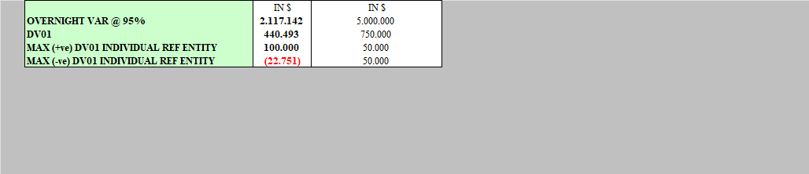
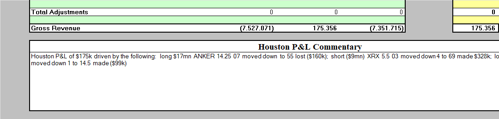
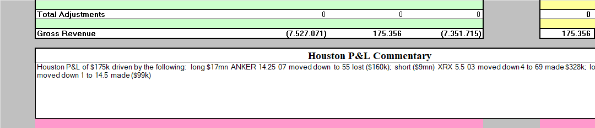

# Empty cells that override column fills

Enron case `ccde4294bab9094d7d73` compares the converted original, Excel Shrink Default and desktop Excel Check Performance after Optimize All.

## Finding

Check Performance removes empty cells whose explicit gray fill masks a pink column fill. Removing those cells exposes the inherited pink background. Excel Shrink retains the overrides because they affect the visible sheet, even below the last populated row. Empty cells can carry visible formatting.

On PL-Consolidated, 190,872 cells present only in Default use the gray fill. They occupy rows 31–17,382 in columns B:F, H:J and L:N. PL-Houston has another 21,342 cells present only in Default, including 21,288 with that gray fill. The last populated rows are 29 and 35 respectively.

The gray fill is indexed color 22 (#C0C0C0). The column fill is indexed color 45 (#FF99CC). Excel's displayed interior color at B1000 confirms gray in Default and pink after Check Performance on both sheets. Across the workbook, 216,781 empty cell records are present only in Default. Of these, 216,775 disappear during Optimize All plus Save and six during the first normal open/save. These counts describe structural differences and do not establish the author's formatting intent.

## Recalculation control

Each XLSX was copied at the filesystem level, opened in Excel 16.0 build 20326, fully recalculated with CalculateFullRebuild and saved with Workbook.Save. Calculation completed before capture. Macros were disabled and external links were not refreshed. Cached external-link data was retained.

The screenshots use 100% zoom with gridlines enabled. Original and Default are pixel-identical in both captured regions. Check Performance still exposes pink. The earlier strikethroughs disappear after recalculation, identifying them as stale-value overlays. This check covers the two pictured regions.

| Variant | Before full rebuild, bytes | After full rebuild and Save, bytes |
| --- | ---: | ---: |
| Original | 3,487,635 | 3,353,730 |
| Default | 2,905,333 | 2,933,834 |
| Check-Performance | 2,285,045 | 2,286,815 |

## Files

The evidence bundle is stored at `F:\corpora\paper-cases\enron-fill-override-ccde4294`. It contains the legacy XLS, three input XLSX files, three rebuilt XLSX files, six screenshots and the analysis records. `manifest.csv` records SHA-256 checksums. `provenance.json` identifies the source and capture method.

### PL-Consolidated

### PL-Houston

