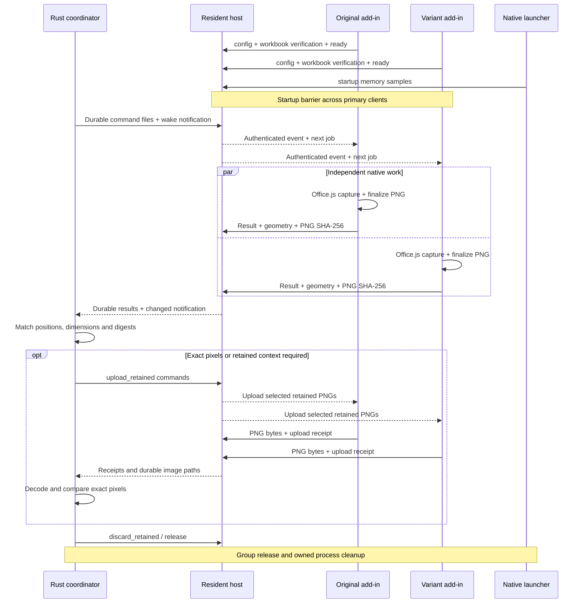

# DeltaSieve communication and lifecycle inventory

Reviewed on 11 November 2026 against source revision
`1b9ee98e3409c3584ffd12a661d0c19f8a5f0788` in `F:/repos/excel-shrink-rust`.
`inventory.json` records the reviewed source hashes and the HTTP/WebSocket route
paths declared by the host modules. This review covers the resident capture
protocol, classic paired capture, targeted native-operation transport,
coordinator lifetime and the Control Room observation/control interface.
The companion [visualization review](visualization-references.md) maps this
protocol to evaluated and award-recognized visual representations.

## Actors and ownership

| Actor | Responsibility and peers | Source entry point |
| --- | --- | --- |
| Archive runner / batch scheduler | Starts workbook workers, refreshes the parent heartbeat and coordinates group cleanup and restart | `regression/archive/worker.rs`, `archive/study/execution.rs`, `archive/batch_cleanup.rs` |
| Rust comparison coordinator | Plans captures, publishes per-client commands, consumes receipts, joins original/profile observations and selects evidence | `regression/office_capture/resident_capture.rs` and its hash/pipeline modules |
| Rust resident capture host | Serves the add-in, authenticates sessions, dispatches durable commands, receives images/results and exposes health | `capture_host/resident.rs`, `resident_events.rs` |
| Original add-in | Verifies its workbook, reads native geometry, captures finalized images and returns hashes, images, resources and results | `office-capture/web/resident.js` |
| Comparison add-ins | Execute the same protocol for physical variant workbooks. Logical profiles can alias one physical client | `resident_capture.rs::client`, `close`, and `web/resident.js` |
| Excel and Office.js runtime | Executes workbook reads, `context.sync()` and native image export inside each owned session | `web/resident.js::createWorker` |
| PowerShell resident launcher | Opens and owns Excel sessions, samples native processes, publishes diagnostics, observes coordinator lifetime and performs cleanup | `office-capture/resident.ps1`, `resident/Opening.ps1`, `ResidentProcesses.cs` |
| Targeted native-operation host | Accepts Rust JSON commands and drives persistent Excel lanes through the native launcher and Office.js protocol | `targeted_comparison/host.rs`, `targeted-comparison-host.ps1`, `TargetedResident.psm1` |
| Warm workbook pool and native worker | Leases an owned Excel worker to a comparison, authenticates commands and retires failed workers | `regression/workbook_worker/pool.rs`, `WorkbookPool.psm1`, `CaptureWorkbookWorker.cs` |
| Classic paired host and comparison consumer | Pairs original/shrunk geometry, heights and images, then exchanges bounded frames and acknowledgments with its consumer | `capture_host/classic.rs`, `paired.rs`, `web/app.js` |
| Control Room browser and service | Presents observed status/evidence and sends user pause, stop, restart and inspection requests | `capture_host/control_room.rs`, `control_room/live_stream.rs` |

Rust paths above are relative to `excel-shrink-cli/src/`. Add-in and launcher
paths are relative to `excel-shrink-cli/`. The remaining tables use these same
abbreviations.

## Resident communication topology

The sequence illustrates the hash-first mode. Its exchanges pass through the
host and coordinator. Add-ins retain finalized PNGs for later upload. They can
perform native work concurrently in separate Excel sessions. The coordinator
joins their evidence and requests additional bytes where needed.

## Startup, identity and dispatch

| Exchange | Payload and effect | Contract |
| --- | --- | --- |
| Add-in → `/config` | Client identity, pane document UUID, run UUID and request UUID. Response includes workbook configuration and client token | Subsequent mutations recheck the current registered client and `X-Client-Token` at the mutation boundary |
| Add-in → `/ready` | Verified workbook identity and bounded startup observations, or an explicit initialization failure | A configured pane must verify the expected workbook before work admission |
| Launcher → `/launcher/startup-sampled/{id}` | Client ready timestamp and native startup measurement acknowledgment | Timestamp must match the current ready observation |
| Launcher → reset/diagnostics endpoints | Authenticated reset stages and diagnostic event batches | `X-Launcher-Token` has a separate role. Diagnostics retain event IDs across retries |
| Coordinator → command file | Monotone command ID, operation kind, requested tiles and queue timestamp | Atomic publication under `commands/{client}/{id}.json` makes the command recoverable |
| Host → dispatch receipt | `dispatched/{client}/{id}.json` with dispatch timestamp | Tracks admission separately from queue time |
| Host → add-in | Command returned by a WebSocket `next` request, with `/job` also exposed | One active command per client. Reconnection can return that same active payload |
| Startup barrier | All primary clients are ready and their startup samples acknowledged | Prevents one primary add-in from starting data work before its peers complete startup sampling. A two-second startup quiet period also applies |
| Pause control | `control.json` retains the last successfully read pause state | New captures wait. Upload/discard/release commands can drain already retained images |

## Messages and evidence

| Channel | Messages | Meaning and bounds |
| --- | --- | --- |
| Resident WebSocket `/events` | First message authenticates `worker` or `coordinator`; subsequent messages include `next`, `wake`, `changed`, `idle`, `job` and `error` | Revision notifications coalesce changes. Files retain authoritative commands/results. Messages and frames are capped at 16 KiB |
| Add-in HTTP result | `/result/{client}/{command}` with `ok`, command output, timings and pane resources | Host validates command identity and evidence completeness before publishing the response and returning an acknowledgment |
| PNG upload | `/image/{client}/{command}/{sheet}/{tile}`, optional `X-Sha256` | Expected sheet/tile identity, PNG framing, dimensions, byte/hash receipts and safe image bounds are checked |
| Diagnosis upload | `/diagnosis-image/{client}/{command}` | Separately identified diagnostic image evidence |
| Resident health | `/health` | Client readiness, command/error state, actual heartbeat observations and bounded monitor/resource samples |
| Control Room live stream | `/api/live` | Three-second snapshot/patch sequence. Browser connection loss ends that observation stream |
| Control Room commands | Pause/control, run stop/terminate, group restart, targeted compare and manual inspection/capture routes | Operator intent is routed through the service and durable controls. Exact declared paths are indexed in `inventory.json` |
| Native-operation transport | Rust stdin/stdout ↔ `targeted-comparison-host.ps1`, one JSON command/result per line | Commands include open/open_batch, capture_batch, save_as, optimize, move_lane and delegated Office.js jobs. Responses include operation measurements before and after execution |
| Warm workbook lease | Launcher ↔ loopback HTTP pool using `X-Pool-Token` and `X-Lease-Token` | `/acquire`, `/command/{index}` and `/release/{index}` bind work to a comparison and worker slot |
| Warm native worker | Rust pool ↔ C# worker stdin/stdout | Serial, bounded JSON commands with request IDs and matching replies. The worker owns one warm Excel application |

### Resident command vocabulary

`plan` obtains native capture geometry. `capture` supports the sweep protocol.
`capture_images` captures and uploads images, while `capture_hashes` offers
finalized PNG hashes and retains those PNGs. `images` and `upload_retained`
provide selected evidence. `discard_retained` releases selected buffered PNGs.
`release` clears capture-plan and geometry state, with optional capture-ID scope.
`diagnosis` provides supported native inspection. Process closure follows the
coordinator/launcher lifecycle and has its own receipts.

### Hash domains

| Hash | Producer and consumer | Decision it supports |
| --- | --- | --- |
| Finalized PNG SHA-256 | Add-in → host → coordinator | Equal geometry and equal PNG digests qualify the hash-equal branch. Unequal PNG encodings can still decode to equal pixels |
| Decoded RGBA digest and exact pixels | Rust image-comparison stage | Compares a common pixel domain across peers after required retained images are uploaded |
| Result JSON SHA-256 | Host over the received result representation | Identical last-result retry acknowledgment within an authenticated pane session |
| Package/member fingerprints | Preparation and reuse analysis | Input/control identity and reuse policy. Their domain is separate from image evidence |

`resident_capture_hashes.rs::equal_offers` checks dimensions along with digests.
The coordinator validates offered tiles against planned geometry. Required
uploads include unequal digest positions, height-sensitive sheets and context.
Context uses retained captures. A boundary image can be spilled to disk for the
following batch. Upload and discard decisions therefore depend on comparison
and context, in addition to byte-hash equality.

## Backpressure, acknowledgment and recovery

* `resident_capture_pipeline.rs::CaptureWindow` reserves credits through image
  comparison, including queued decoding. Two lookahead batches bound independent
  client dispatch. A slow peer constrains the common comparison frontier.
* Resident limits include 16 pending tiles, 64 million pending pixels and
  512 MiB pending PNG bytes per client. Request size, image validity and actual
  native capture geometry have additional checks.
* Hash-first mode retains one bounded capture window until upload/discard
  decisions complete. The live-image path permits bounded upload overlap with
  the next native batch, with previous upload failures propagated before
  further work is accepted.
* `resident-connection.js::runJobs` requests the next job after the current
  result is acknowledged. It remembers the completed command and serialized
  result. An acknowledgment loss replays that result body.
* `resident.rs::result` accepts an identical retry of the last result and rejects
  a changed retry or an obsolete active command. Publication is checked against
  existing durable responses. This supplies bounded retry safety within the
  represented session.
* `resident_events.rs` observes durable files before authentication completes,
  and revision reconciliation covers changes during dispatch. File-watcher
  failure becomes an explicit protocol error.
* Add-in reconnect uses the existing identity/token, ignores superseded socket
  callbacks and preserves a pending request. Retired sessions fail immediately.
  Rust coordinator reconnect also reconciles durable observations.

## Heartbeats, deadlines and shutdown

| Signal or clock | Owner | Current consequence |
| --- | --- | --- |
| Resident add-in heartbeat every 5 s | `web/resident.js` → resident host | Reports actual heartbeat time/count and bounded pane resources. Failure is surfaced through the main job/connection path |
| Classic add-in heartbeat every 2 s, 2 s request budget | `web/app.js` → `/telemetry` | Failed heartbeat telemetry disables that observation channel while capture requests retain their own error handling |
| Event authentication/send budget 10 s | Host `resident_events.rs` | Bounds a connection that fails authentication or stops accepting event messages |
| Resident add-in reconnect/result retry budget 120 s | `web/resident-connection.js` | Exhausted transport recovery fails the client loop. Result retries use backoff from 250 ms, capped at 5 s, for transport errors, 408, 429 and 5xx |
| Rust event-loop health check every 1 s | `office_capture/resident_events.rs` | Gives the synchronous coordinator opportunities to inspect exit, restart and deadlines |
| Per-command active deadline | `ResidentCapture::wait`, live control settings | Uses dispatch/readiness, opening-pause credit and user-pause accounting. Launcher failure, process exit and restart are checked while waiting |
| Verified-progress idle timeout, default 120 s | `run-targeted-comparison.ps1` | Only increases in capture-success/progress sequences reset this clock. Expiry disposes the owned attempt |
| Parent heartbeat file younger than 60 s | `archive/batch_cleanup.rs::parent_alive` | Archive worker watchdog checks every 2 s. An expired/missing parent heartbeat triggers owned cleanup and worker exit 124 |
| Archive worker deadline, default 1800 s | `archive/worker.rs::start_watchdog` | Enforces the configured active budget with cleanup-gate and manual-control conditions |
| Native startup deadline | `resident.ps1::Test-ResidentDeadline`, `resident/Opening.ps1` | Bounds opening using current startup controls |
| Legacy total session deadline | `resident.ps1::Test-ResidentDeadline` | Applies to sessions outside live control. Live sessions use coordinator/job ownership and pause-aware controls |
| Coordinator process handle | Launcher `Update-Resources`, `Wait-BatchRelease` | Owner exit triggers failure/release and cleanup. Process handles protect the observation against PID reuse |
| Physical RAM and commit reserve | Launcher `Update-Resources`, `Wait-BatchRelease` | Insufficient reserve causes failure or early cleanup release |
| Batch ready/release markers and pause counter | Rust `batch_cleanup.rs` and launcher `Wait-BatchRelease` | Preserve readiness timestamp and opening-pause baseline. Finished groups retain ownership through the configured peer cleanup gate |
| `finish.json`, per-client close markers | Rust coordinator → launcher | Requests session completion or physical-client closure. The coordinator checks launcher exit and completion metrics |
| Owned Windows job / cleanup confirmation | Launcher and native-operation host | Kill-on-close ownership covers the owned process group. Attempted termination and confirmed process exit have separate outcomes |

Add-in heartbeat, native process liveness and verified progress are independently
observed signals. The explicit heartbeat-expiry termination path above belongs
to parent-runner supervision. Batch waiting also checks coordinator handles,
memory and active deadlines. Its source explicitly protects peer sessions from
premature disposal during a quiet interval.

## Classic paired mode

`classic.rs` exposes `/pair/geometry`, `/pair/heights`, `/pair/sheet` and
`/pair/image`. `paired.rs::Exchange` accepts one contribution from each of
`original` and `shrunk`, checks pair identity and blocks the next exchange until
the consumer acknowledges the current one. The host forwards paired metadata
and image bytes through a Windows named pipe to the comparison consumer.
Its connection budget is 30 seconds and peer/exchange waits use 120 seconds.
This paired rendezvous is an additional protocol alongside resident command
dispatch. Its wait state, pairing checks and consumer acknowledgment deserve
their own sequence diagram.

## Optional warm-worker lease protocol

`WorkbookPool.psm1` validates a loopback HTTP origin and credentials. Acquire
retries retain the same comparison identity. A lease identifies the slot,
comparison, capture port, manifest and lease token. Commands include `open`,
`open_working_copy`, `close`, `save_copy`, `save_as`, `rebuild`, `chart_sheets`
and `export_chart`. The server checks lease state before executing commands.
A failed command retires its worker. Repeated release tokens are acknowledged
without affecting a subsequent lease. Native-worker requests and replies have
their own serial framing and process ownership under
`regression/workbook_worker/`. This channel complements the add-in's capture
transport when warm-worker pooling is enabled.

## Verification performed

The existing JavaScript connection suite passed all 11 tests. It exercises
lost wakeups, reconnect identity, retired sessions, bounded recovery,
acknowledgment loss, duplicate completed commands and single execution.

The existing `resident-control.tests.ps1` and `resident-cleanup.tests.ps1`
suites also passed. They exercise deadline handling, actual heartbeat versus
process observations, coordinator death, pause-credit accounting and cleanup
gates using test fixtures. Windows PowerShell initially rejected script loading
under its execution policy. The successful rerun used a process-scoped
`-ExecutionPolicy Bypass`. Temporary test files were placed under
`F:/corpora/protocol-inventory-20261111/test-temp`.

Native multi-Excel execution was not rerun for this inventory. Rust host,
receipt and hash-comparison tests were inspected as source. This review adds
documentation and source indexing.

## Diagram candidates

1. A multi-actor sequence for config/ready/startup sampling, capture, hash offer,
   retained upload and result acknowledgment.
2. A separate failure/lifetime sequence showing parent heartbeat, verified
   progress, transport recovery, cleanup gates and owned process exit.
3. A credit-window diagram showing original and variant streams converging at
   the comparison frontier, with retained PNG ownership until release.

These three views explain communication, supervision and bounded evidence
ownership with distinct visual encodings.
